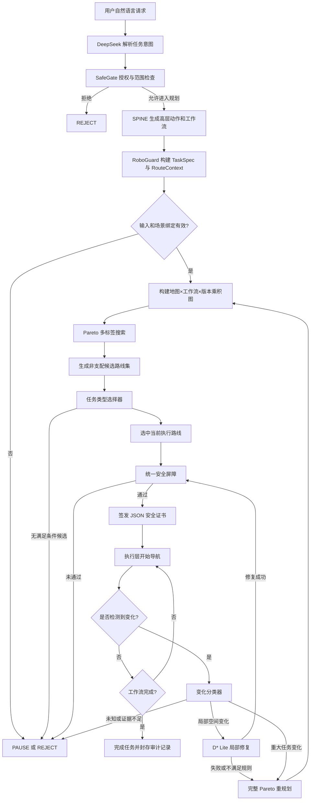

# RoboGuard 修改完成后的模型工作流程

## 1. 文档说明

本文描述 RoboGuard 五日改造计划全部完成后的目标工作流程，包括任务输入、授权、工作流建模、Pareto 多目标路径搜索、任务类型选择、统一安全审查、D* Lite 局部修复、重大变化重规划和审计输出。

本文描述的是改造完成后的目标架构，不代表文档编写时所有模块均已实现或完成真实医院验证。

## 2. 系统目标

RoboGuard 的目标不是单纯寻找最短路径，而是在医院导航场景中完成以下闭环：

1. 根据授权任务和当前医院场景生成多条安全可行路线；
2. 同时考虑医疗风险、距离、时间和患者负担；
3. 根据任务类型从 Pareto 候选集中选择当前执行路线；
4. 使用工作流状态保证有序到达、确认、交接和完成；
5. 在局部空间变化时使用 D* Lite 增量修复路线；
6. 在任务、患者或风险规则重大变化时重新运行 Pareto 搜索；
7. 所有初始路线、修复路线和重规划路线都必须经过同一个安全屏障；
8. 只有获得安全证书的路线才能进入执行层。

## 3. 系统角色分工

| 模块 | 主要职责 | 不负责的内容 |
|---|---|---|
| DeepSeek | 理解自然语言、提取任务意图、辅助补全高层信息 | 不直接计算路径，不签发执行许可 |
| SafeGate | 检查身份、权限、目标和授权范围，生成受约束的授权任务 | 不决定具体路线 |
| SPINE | 将授权任务组织为高层动作和工作流步骤 | 不绕过 RoboGuard 安全审查 |
| RoboGuard | 确定性路径计算、工作流状态管理、动态重规划和最终安全审查 | 不接受大模型临时生成任意代价公式 |
| 执行层 | 根据有效安全证书执行导航动作并上报状态 | 不直接执行未经安全屏障签发的路线 |

## 4. 总体工作流程



## 5. 阶段一：自然语言理解

用户可以使用自然语言提出任务，例如：

> 请带轮椅患者从挂号区前往检查室，确认后再去呼吸科。

DeepSeek 负责识别以下高层信息：

- 导航任务类型；
- 起点和有序目的地；
- 患者或用户角色；
- 轮椅、无台阶、电梯等无障碍需求；
- 是否携带药品、样本或其他物品；
- 普通、优先、紧急或急救等级；
- 是否需要确认、交接或人工复核。

自然语言模型的输出不能直接驱动机器人，也不能直接决定路线。其输出必须先经过 SafeGate 授权和 RoboGuard 结构化校验。

## 6. 阶段二：SafeGate 授权

SafeGate 检查任务是否允许进入规划阶段，主要包括：

- 请求者身份和角色是否有效；
- 请求目标是否属于允许的导航目标；
- 请求者是否具有进入相关区域的权限；
- 授权目标与任务参数中的目标是否一致；
- 授权是否绑定当前医院场景快照；
- 是否包含 `REQUIRE_ROBOGUARD_EXECUTION_CHECK` 义务；
- 授权范围是否仅允许进入规划，而不是直接执行。

授权成功后输出至少包含：

```json
{
  "authorization_id": "...",
  "request_id": "...",
  "action_type": "NAVIGATE_TO_LOCATION",
  "target": {
    "kind": "LOCATION",
    "id": "..."
  },
  "authorization_scope": "ALLOW_TO_ENTER_PLANNING",
  "context_id": "...",
  "obligations": [
    "REQUIRE_ROBOGUARD_EXECUTION_CHECK"
  ]
}
```

授权失败时直接返回 `REJECT`，不进入路径搜索。

## 7. 阶段三：SPINE 高层工作流生成

SPINE 根据授权任务生成高层动作序列，例如：

```text
goto(检查室)
confirm(检查室)
goto(呼吸科)
handoff(呼吸科)
finish()
```

SPINE 只表达任务步骤，不负责选择地图路径。RoboGuard 会检查动作目标、顺序和授权范围，防止出现以下情况：

- 导航到未授权目标；
- 跳过中间目的地；
- 未确认就继续下一阶段；
- 未交接就完成任务；
- 在暂停状态下继续执行；
- 使用已经失效的计划版本。

## 8. 阶段四：构建可信任务契约

RoboGuard 将授权任务和场景快照转换为两个只读结构。

### 8.1 TaskSpec

`TaskSpec` 描述任务本身：

```text
task_type
source_region_id
ordered_destination_ids
user_role
accessibility_needs
carrying_item_ids
urgency
schema_version
```

### 8.2 RouteContext

`RouteContext` 描述任务执行时的可信环境：

```text
authorization_id
request_id
authorization_scope
scene_snapshot_id
scene_snapshot_hash
map_id
map_version
current_time
dynamic_events
schema_version
```

如果授权目标、当前机器人位置、场景快照或任务参数不一致，RoboGuard 必须停止规划并返回 `PAUSE` 或 `REJECT`。

## 9. 阶段五：工作流自动机

RoboGuard 使用确定性工作流自动机记录任务进度。典型状态包括：

```text
WAITING_DESTINATION_1
WAITING_CONFIRMATION_1
WAITING_DESTINATION_2
WAITING_HANDOFF
READY_TO_FINISH
COMPLETED
PAUSED
```

工作流转移表示为：

\[
q' = \delta(q, a)
\]

其中 \(q\) 是当前工作流状态，\(a\) 是到达、确认、交接、完成、暂停或重规划动作。

只有满足当前工作流规则的动作才能产生新状态。错误顺序不会被记录为成功，而会触发暂停或拒绝。

## 10. 阶段六：构建乘积图

医院地图表示为图：

\[
G=(V,E)
\]

其中 \(V\) 为地图节点，\(E\) 为可通行连接。

RoboGuard 实际搜索的是乘积图状态：

\[
x=(v,q,k)
\]

其中：

- \(v\)：当前地图节点；
- \(q\)：当前工作流状态；
- \(k\)：当前计划版本。

同一地图节点在不同工作流状态或不同计划版本下属于不同搜索状态。这样可以防止搜索结果跳过确认、交接或版本失效检查。

只有满足以下全部条件时，乘积图中的状态转移才有效：

```text
地图连接有效
节点和边没有被封闭
用户角色具有访问权限
满足无障碍要求
携带物允许进入相关区域
区域策略允许通行
动态状态没有过期
工作流转移合法
计划版本仍然有效
```

## 11. 阶段七：Pareto 多目标搜索

### 11.1 路线标签

每条到达乘积状态的路线使用一个标签表示：

\[
L=(x,R,D,T,B,P,C_R,W)
\]

其中：

- \(x\)：当前乘积状态；
- \(R\)：累计医疗风险；
- \(D\)：累计距离；
- \(T\)：累计预计时间；
- \(B\)：累计患者负担；
- \(P\)：完整路径；
- \(C_R\)：风险组成；
- \(W\)：工作流轨迹。

### 11.2 支配关系

对于到达同一乘积状态的标签 \(L_1\) 和 \(L_2\)，如果 \(L_1\) 在风险、距离、时间和患者负担上都不差于 \(L_2\)，并且至少一项严格更优，则认为 \(L_1\) 支配 \(L_2\)。

\[
L_1 \prec L_2
\]

被支配标签可以删除；互有优劣的标签必须同时保留。

### 11.3 搜索步骤

1. 为起点创建初始标签；
2. 从优先队列取出待扩展标签；
3. 枚举当前节点的后继节点；
4. 检查空间、权限、无障碍、携带物、动态事件和工作流硬约束；
5. 对合法转移累计风险、距离、时间和患者负担；
6. 将新标签与目标状态已有标签比较；
7. 删除被新标签支配的旧标签；
8. 如果新标签被支配或完全重复，则丢弃；
9. 否则将新标签加入该状态的 Pareto 前沿；
10. 到达最终目的地且工作流处于可接受状态时，加入最终候选集；
11. 对最终候选再次执行非支配过滤和确定性排序。

### 11.4 标签数量控制

为了避免候选数量失控，系统设置：

```text
max_labels_per_state
max_final_candidates
dominance_epsilon
```

超过容量时优先保留风险最低、距离最短、时间最快和患者负担最低的代表路线，然后按稳定顺序填充剩余容量。

因此，在启用容量限制时，输出属于有界近似 Pareto 前沿，而不是无条件保证完整的数学 Pareto 前沿。

## 12. 阶段八：任务类型选择器

Pareto 搜索负责产生候选集，任务类型选择器负责确定当前执行路线。

### 12.1 候选过滤

选择器先删除不满足任务特定要求的候选。例如：

- 轮椅任务删除包含楼梯或不可通行区域的路线；
- 低感官负担任务删除经过高噪声或高拥挤区域的路线；
- 药品或样本运输删除违反携带物策略的路线；
- 紧急任务仍必须先满足全部安全硬约束；
- 未完成确认或交接的路线不能作为完成路线。

### 12.2 确定性选择

不同任务类型使用经过审核的结构化配置：

| 任务类型 | 主要选择倾向 |
|---|---|
| 普通导诊 | 平衡风险、距离和时间 |
| 行动不便 | 降低患者负担，减少复杂通道 |
| 轮椅任务 | 无障碍为硬条件，再比较负担与距离 |
| 紧急任务 | 满足安全条件后优先时间 |
| 药品或样本运输 | 携带物限制和交接流程优先 |
| 高风险患者 | 医疗风险优先 |

大模型不能临时生成任意权重或代价函数。相同输入和配置必须得到相同选择结果。

### 12.3 选择审计

选择结果必须记录：

- 被选候选的编号和路线；
- 任务类型和选择配置版本；
- 选择原因；
- 未选候选；
- 风险差、距离差、时间差和患者负担差；
- 被过滤候选及过滤原因。

如果没有满足任务要求的候选，返回 `PAUSE` 或 `REJECT`。

## 13. 阶段九：统一安全屏障

安全屏障是唯一允许签发可执行路线的模块。它接收三种来源的结果：

1. 初始 Pareto 搜索和任务选择结果；
2. D* Lite 局部修复结果；
3. 重大变化后的完整 Pareto 重规划结果。

安全屏障重新检查：

- 授权 ID、请求 ID 和授权范围；
- 授权与场景快照绑定；
- 场景哈希和地图版本；
- 当前计划版本；
- 路线节点和边的连续性；
- 区域权限；
- 无障碍需求；
- 携带物限制；
- 动态事件和状态有效期；
- 工作流到达、确认、交接和完成顺序；
- 风险上限和任务选择规则；
- 机器人运行状态和导航能力。

安全屏障不应只相信规划器给出的“已检查”标志，而应根据路线、任务和当前场景重新验证关键条件。

通过安全屏障后，系统生成 JSON 安全证书；未通过时返回安全暂停或拒绝。

## 14. 阶段十：安全证书与执行

安全证书至少包括：

```json
{
  "schema_version": "1.0",
  "authorization_id": "...",
  "request_id": "...",
  "scene_snapshot_id": "...",
  "scene_snapshot_hash": "...",
  "map_id": "...",
  "map_version": 1,
  "plan_version": 3,
  "planner": "pareto",
  "selected_route": [],
  "candidate_routes": [],
  "selection_reason": "...",
  "risk_score": 0.0,
  "risk_components": {},
  "workflow_trace": [],
  "dynamic_events": [],
  "checked_rules": [],
  "decision": "ALLOW"
}
```

执行层接收证书后还要确认：

- 证书签发的计划版本等于当前版本；
- 场景哈希没有变化；
- 证书没有被撤销；
- 路线下一步与机器人当前位置一致。

任一检查失败，执行层必须停止并请求重新审查。

## 15. 阶段十一：运行时监控

机器人执行期间持续接收：

- 节点或边封闭；
- 临时障碍；
- 拥挤或通行时间变化；
- 电梯不可用；
- 患者状态变化；
- 目标变化；
- 权限变化；
- 携带物变化；
- 工作流变化；
- 医疗风险规则变化；
- 场景快照和地图版本变化。

所有变化首先进入变化分类器，不能直接修改执行路线。

## 16. 阶段十二：变化分类

变化分类器输出三类结果：

| 分类 | 示例 | 处理方式 |
|---|---|---|
| `LOCAL` | 局部封路、局部障碍、单条边成本变化 | 尝试 D* Lite |
| `MAJOR` | 目标、患者状态、权限、携带物、工作流或风险规则变化 | 废止旧版本并完整重规划 |
| `UNKNOWN` | 变化信息不完整、类型未知或证据冲突 | 进入安全暂停 |

分类器必须采用结构化规则，不能依赖大模型自由判断执行安全。

## 17. 阶段十三：D* Lite 局部修复

D* Lite 用于已经选定路线后的局部空间变化。它保存：

```text
g 值
rhs 值
优先队列
前驱关系
后继关系
当前起点
目标节点
当前边代价
计划版本
```

对于状态 \(s\)：

\[
rhs(s)=\min_{s'\in Succ(s)}\left(c(s,s')+g(s')\right)
\]

当 \(g(s)=rhs(s)\) 时，该状态是一致的。局部边发生变化后，D* Lite 只更新受影响区域中的不一致状态，而不是从头搜索整张图。

局部修复流程：

1. 接收已分类的局部变化；
2. 增加计划版本并使旧执行证书失效；
3. 更新受影响节点和边的通行状态或代价；
4. 保留已经执行且未受影响的路线前缀；
5. 更新相关状态的 `rhs` 和优先级；
6. 运行增量搜索直到当前起点重新一致；
7. 从当前位置提取修复路线；
8. 检查修复路线是否仍满足原任务类型和风险限制；
9. 将修复结果提交统一安全屏障；
10. 获得新安全证书后继续执行。

以下任一情况会使局部修复升级为完整 Pareto 重规划：

- D* Lite 找不到替代路线；
- 修复路线违反硬约束；
- 修复路线超过风险上限；
- 修复路线不满足任务选择规则；
- 工作流状态无法继续；
- 变化实际影响任务语义；
- 计划版本或场景绑定不一致。

## 18. 阶段十四：完整 Pareto 重规划

出现重大变化时，旧任务模型或旧候选集已经不再有效。系统执行：

1. 将旧计划版本标记为失效；
2. 撤销旧安全证书；
3. 从机器人当前位置建立新的起点；
4. 更新患者状态、目标、权限、携带物和动态事件；
5. 保留仍然有效的工作流完成记录；
6. 生成新的 `TaskSpec` 和 `RouteContext`；
7. 使用新计划版本重建乘积图初始状态；
8. 重新运行 Pareto 多目标搜索；
9. 重新运行任务类型选择器；
10. 将新路线提交统一安全屏障；
11. 获得新安全证书后恢复执行。

旧计划即使晚到，也会因为计划版本或场景哈希不匹配而被拒绝。

## 19. 决策状态

系统统一使用以下决策：

### 19.1 ALLOW

表示路线已经通过统一安全屏障并获得有效安全证书，可以进入执行层。

### 19.2 PAUSE

表示当前不能安全继续，但任务可能恢复，例如：

- 等待确认或交接；
- 场景信息不完整；
- 动态变化类型未知；
- 当前路线失效且正在重规划；
- 暂时没有替代路线；
- 需要人工复核。

### 19.3 REJECT

表示任务或路线明确不允许执行，例如：

- 授权无效；
- 目标未授权；
- 明确违反区域权限；
- 请求动作类型不受支持；
- 任务参数与授权目标冲突。

## 20. 端到端示例

任务：带轮椅患者从挂号区前往检查室，确认后再前往呼吸科。

1. DeepSeek 识别为轮椅、多阶段导诊任务；
2. SafeGate 检查请求者权限并授权两个有序目的地；
3. SPINE 生成“前往检查室、确认、前往呼吸科、完成”的工作流；
4. RoboGuard 构建 `TaskSpec` 和 `RouteContext`；
5. 系统建立地图、工作流和计划版本组成的乘积图；
6. Pareto 搜索生成多条满足无障碍和权限要求的路线；
7. 候选 A 最短但拥挤，候选 B 稍长但患者负担低，候选 C 风险最低但耗时最长；
8. 轮椅任务选择器选择候选 B；
9. 统一安全屏障复查授权、无障碍、工作流和风险；
10. 安全屏障签发版本 1 的安全证书；
11. 机器人开始执行；
12. 前方走廊封闭，变化分类器将其判定为局部变化；
13. 旧证书失效，D* Lite 保留未受影响前缀并修复后续路线；
14. 修复路线通过安全屏障，系统签发版本 2 的安全证书；
15. 患者状态突然恶化，目标改为急诊；
16. 分类器将其判定为重大任务变化；
17. 版本 2 立即失效，系统重新构建任务并运行完整 Pareto 搜索；
18. 新路线通过安全屏障后获得版本 3 的安全证书；
19. 机器人按照版本 3 路线继续执行；
20. 到达急诊并完成交接后，工作流进入 `COMPLETED`。

## 21. 审计输出

每次规划、修复、重规划和执行决定都应记录：

- 授权 ID 和请求 ID；
- 场景快照 ID 和哈希；
- 地图版本和计划版本；
- 任务契约；
- 动态事件；
- Pareto 候选集；
- 被支配和被容量裁剪的标签数量；
- 任务选择配置和选择理由；
- 被选路线及未选路线差异；
- 工作流轨迹；
- 风险总分和风险组成；
- 安全屏障检查项；
- 最终决策及原因码；
- D* Lite 更新的边、扩展状态数和保留前缀；
- 完整重规划触发原因；
- 安全证书签发、撤销和失效记录。

## 22. 与 Dijkstra 的区别

| 项目 | Dijkstra | 修改后的 RoboGuard |
|---|---|---|
| 搜索状态 | 地图节点 | 地图节点 × 工作流状态 × 计划版本 |
| 优化目标 | 距离 | 风险、距离、时间、患者负担 |
| 每个状态保存结果 | 一个最短距离 | 多个非支配标签 |
| 权限和医疗规则 | 通常不处理 | 搜索前和扩展时作为硬约束 |
| 多阶段工作流 | 不理解 | 工作流自动机约束 |
| 输出 | 单一路径 | 候选集、选择结果、解释和证书 |
| 局部变化 | 通常从头搜索 | D* Lite 增量修复 |
| 重大变化 | 无任务语义分类 | 完整 Pareto 重规划 |
| 版本控制 | 通常没有 | 旧计划强制失效 |
| 执行许可 | 路径可直接使用 | 必须经过统一安全屏障 |

## 23. 安全边界

该系统能够保证路线满足已经编码并且当前可观测的约束，但不能仅凭算法结构证明真实医院中的医疗有效性。

最终安全性还依赖：

- 地图与真实医院环境一致；
- 动态事件和传感器数据准确；
- 权限与工作流规则配置正确；
- 医疗风险权重经过专家或真实数据验证；
- 患者负担模型符合实际人群；
- 执行层正确落实安全证书中的路线和版本。

因此，对外结论应表述为：

> RoboGuard 能在当前场景快照、任务授权和已编码规则范围内，生成可解释的多目标安全路线，并在局部或重大变化发生时通过版本化重规划和统一安全屏障维持执行安全。

不应在缺少真实医院统计、专家标注和现场测试时宣称系统已经证明真实临床安全性。

## 24. 完成标准

修改完成后，至少应满足：

- Pareto 搜索能够稳定返回非支配候选路线；
- 任务类型选择器能够解释路线选择原因；
- 多阶段任务不能跳过确认或交接；
- 轮椅和携带物任务不会选择冲突路线；
- 局部变化能够触发 D* Lite 修复；
- 重大变化不会错误使用局部修复；
- 旧计划版本和旧安全证书不能继续执行；
- 三类路线来源全部经过同一安全屏障；
- 无安全证书的路线不能进入执行层；
- 无可行路线时进入安全暂停；
- 相同输入和配置产生完全一致的候选集与选择结果；
- 所有决策都能够通过审计记录复现。
